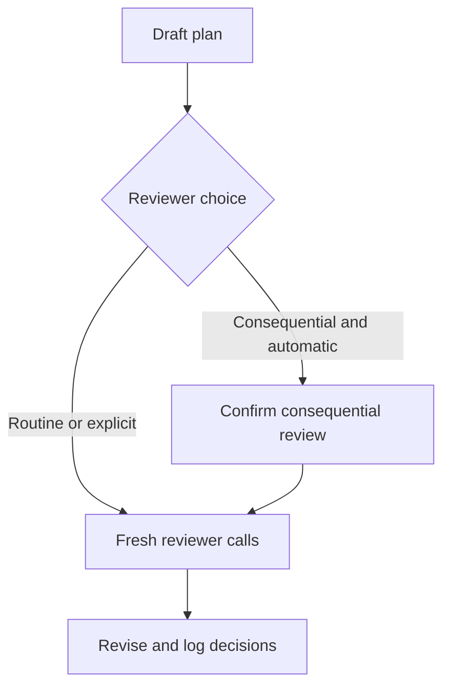

# Plan Challenge

**A cost-aware review workflow for AI-generated project plans.** Use Codex or Claude Code to draft a plan, send the draft to a fresh reviewer, and keep a decision log for the proposed changes.

Most plans get one low-effort Codex review. For consequential work, the skill recommends a deeper Claude review and asks you to choose. When you want two independent opinions, run both reviewers against the same draft before revising it.

## What the tests found

Both reviewers ran live on 12 synthetic plans, twice each (48 calls, 2026-11-19). Six plans have two planted flaws. Six are the same plans with the flaws repaired.

| Measured on the paired benchmark | Codex (low effort) | Claude (medium effort) |
| --- | ---: | ---: |
| Reviews that passed the format check | 24 / 24 | 21 / 24 |
| Planted blockers found | 18 / 18 | 18 / 18 |
| Repaired plans where the old flaw was still claimed | 2 / 12 | 0 / 9 |
| Extra findings judged valid | 17 | 37 |
| Median wall time per review | 7.1 s | 17.9 s |
| Median reported tokens per review | 14,184 | 2,417 |

Both found every planted flaw, so this test does not show which one catches more blockers. Codex was faster and always returned a usable review. Claude wrote about twice as many extra findings that held up. That is the reason the skill recommends Claude for consequential plans. Dollar cost is unknown for Codex because its CLI does not report it. Grading was done blind by an AI grader, not a person.

On the camera-swap pair, both reviewers caught the missing crop offset in every run and neither repeated it on the repaired plan.

- [Full results, failures and limits](docs/portfolio-results.md)
- [Raw reviews, usage files and grading rows](runs/)
- [Earlier pilot on three real plans](docs/benchmarks.md)

## Try it

Clone this repository or extract GitHub's **Download ZIP**. From the repository root, open your preferred CLI. You need Python 3.9+ and a signed-in CLI for each writer or reviewer you use. For the default reviewer, install [Codex CLI](https://developers.openai.com/codex/cli) and run `codex login`. To use Claude as a writer or reviewer, install [Claude Code](https://code.claude.com/docs/en/quickstart) and sign in.

| Goal | Claude Code chat | Codex chat |
| --- | --- | --- |
| Let the skill pick or ask | `/challenge Plan a weekly attendance log` | `$challenge Plan a weekly attendance log` |
| Choose a deeper Claude review | `/challenge claude <idea>` | `$challenge claude <idea>` |
| Get two independent opinions | `/challenge both <idea>` | `$challenge both <idea>` |
| Compare reviewers with repeated runs | `/challenge measure <idea>` | `$challenge measure <idea>` |

You can also enter just the skill name to use the current discussion, or supply a Markdown plan path. Prefix with `codex` to explicitly use Codex, including for consequential plans. This repository is currently private and requires access to clone or download.

### Use it in another project

Copy the [entire skill folder](.claude/skills/challenge/) into the appropriate location. Keep `SKILL.md` and its supporting files together, then start a fresh session.

| Client | One project | All your projects |
| --- | --- | --- |
| Claude Code | `.claude/skills/challenge/` | `~/.claude/skills/challenge/` |
| Codex | `.agents/skills/challenge/` | `~/.agents/skills/challenge/` |

## How it works



- **Cost control.** The regular route uses one reviewer call. A blocker can trigger one recheck. `both` makes two independent calls on the same draft, and `measure` makes four.
- **Isolated review.** Each reviewer starts in a temporary directory and receives the frozen plan and rubric. The runner disables shell tools in Codex and tools in Claude, validates the reply format and keeps per-run usage fields. Remove secrets before sending plan text to a provider.
- **Audit trail.** The output folder keeps `plan-v1.md`, the original critiques, `decisions.md`, and the revised `plan.md`. A failed review is recorded explicitly. The skill stops at planning.

## Evaluation and engineering

The benchmark contains **12 plans in six matched pairs**, with **9 planted blockers and 3 major issues**. The paired controls test whether a reviewer drops a claim once the flaw is repaired. Plans, answer key and scoring rules were frozen before the first call. Each run keeps plan and rubric hashes, CLI versions, usage and failures. 23 offline tests cover both CLI adapters with no model calls.

```sh
python -B -m unittest discover -s tests -v
python evals/plan-review/run_benchmark.py --suite full --dry-run
```

Start with the [real camera-swap decision log](challenge/shot-tracker-new-camera/decisions.md) for an example of reviewer disagreement, then see the [paired benchmark](evals/plan-review/) and [client verification guide](docs/verification.md).
