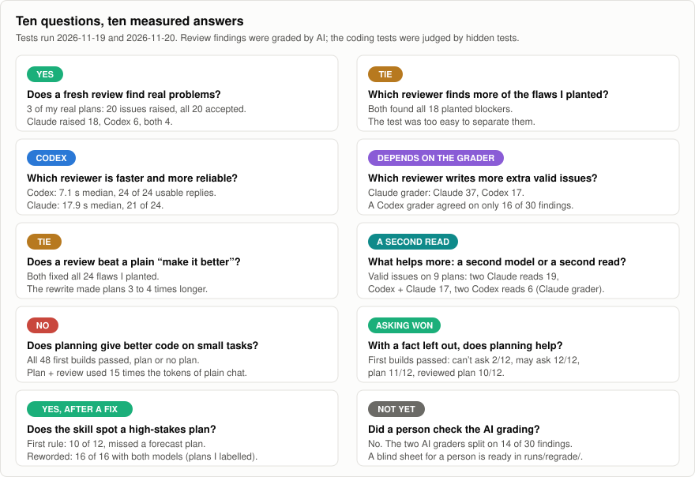
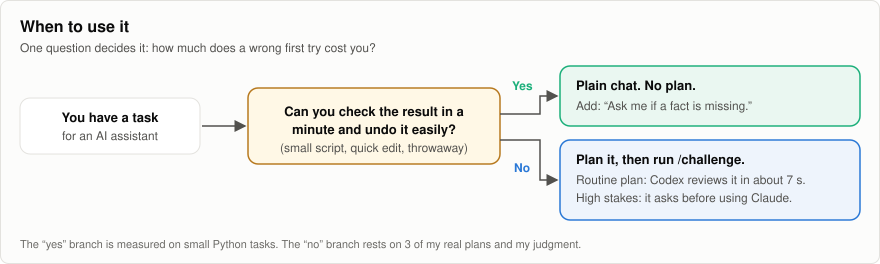
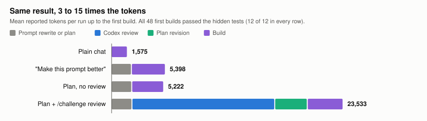
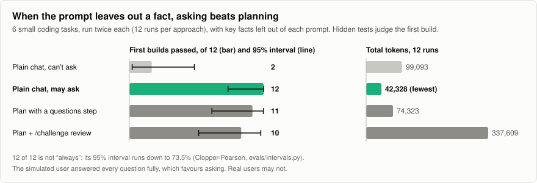
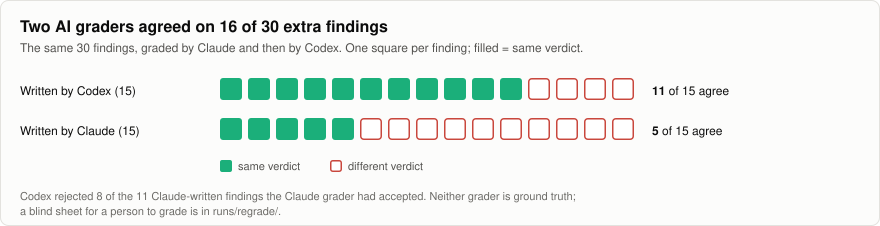
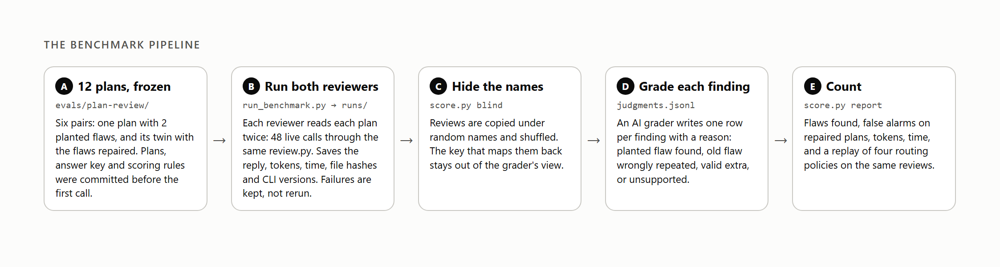

# Plan Challenge

**Does a plan get better when a second AI model reviews it before anything is built?** A small measured study, and the tool I use because of it.

## In one minute

AI coding assistants write confident plans, and the model that wrote a plan tends to agree with it. `/challenge` hands the draft to a fresh reviewer (Codex or Claude) that sees only the plan and a checklist. Every issue it raises gets an accept or reject decision in a log, and the plan is revised before any code is written.


**Short answer: yes, on my own plans, but the second model is not the reason.** One review pass on three real project plans raised 20 issues, and I accepted all 20 before writing any code. In tests with flaws I planted on purpose, any fresh read helped: a second Claude review found more valid issues than a Codex review (by a Claude grader; a Codex grader disagreed on about half), and a plain "make this plan better" fixed the planted flaws just as well. **For small coding tasks, skip planning.** On six small functions, plain chat passed every hidden test on the first try. When the prompt left out a fact, plain chat told "ask me if something is missing" did best.

This repo holds the skill, the benchmark I built to test it, and every raw reply behind the numbers below. It is a small study: 12 synthetic plans, AI graders and no human grading yet. See [what this does not show](#what-this-does-not-show).

## What I found



<details>
<summary><b>Caveats and links behind each card</b></summary>

1. **A fresh reviewer finds real problems.** On three of my own project plans, the two reviewers raised 20 distinct issues and I accepted all 20. Claude raised 18 of them and Codex 6. Only 4 were raised by both. ([pilot](docs/benchmarks.md))
2. **On planted flaws the two reviewers tied.** Both found all 18 planted blockers in every completed review. The test is too easy to separate them on this measure.
3. **They differ in speed, reliability and depth.** Codex took 7.1 s per review and always returned a usable reply. Claude took 17.9 s and 3 of its 24 replies broke the required format (24 of 24 passed in a later rerun, after the format check was changed to drop a closing remark). Under the Claude grader, Claude wrote about twice as many extra findings that held up (1.8 per review against 0.7). A Codex grader reversed that on a sample of 30, so this one depends on who grades.
4. **The token gap I had measured came from the setup, not the model.** In the pilot, Claude used 7.6 times the tokens of Codex. That was Claude Code loading its own startup context into every subagent. Run as a standalone process, Claude used about one sixth of Codex's tokens (2,417 against 14,184 median).
5. **A plain "make it better" tied the review on planted flaws.** In a follow-up, one fresh call with that prompt fixed 24 of 24 planted flaws, the same as a review followed by a revision. The rewrite made plans three to four times longer (472 and 381 words against 183 and 212 median). The review route keeps the plan short and leaves a decision log. ([four follow-up tests](docs/portfolio-results.md#follow-up-four-tests-of-the-idea-itself-2026-11-20))
6. **A second read helped more than a second model.** On 9 plans, two Claude reviews found 19 distinct valid issues, one Codex plus one Claude found 17, and two Codex reviews found 6. These counts come from the Claude grader, which a Codex grader agreed with on only 16 of 30 findings.
7. **For small coding tasks, plain chat was enough.** Four ways to get six small functions built, 12 runs each, hidden tests as the judge. All 48 first builds passed. The extra steps bought nothing and cost 3 to 15 times the tokens. ([outcome tests](docs/portfolio-results.md#follow-up-does-the-built-code-get-better-2026-11-20))
8. **When the prompt left out a fact, asking won.** In a second run the prompts left out key facts (a tick rate, a crop size). Plain chat that could not ask passed 2 of 12. Told it may ask, it passed 12 of 12, against 11 for a plan with a questions step and 10 for a reviewed plan, using 0.57 and 0.13 times their tokens. ([details](docs/portfolio-results.md#second-outcome-test-the-prompt-leaves-out-a-fact))
9. **The stakes rule needed one fix.** The first wording called the store forecast plan routine with both models (10 of 12). A reworded rule scored 16 of 16 with both. ([details](docs/portfolio-results.md#5-a-reworded-stakes-rule-16-of-16-for-both-models))
10. **No person has checked the AI grading yet.** The two AI graders split on 14 of 30 findings. A blind sheet is ready. ([details](docs/portfolio-results.md#follow-up-a-second-grader-from-the-other-family-2026-11-20))

</details>

## When to use it



Example of the first kind: "Write `gate_time_s(start_tick, stop_tick)` for a 16-bit timer at 10,000 ticks per second." Plain chat got it right in about 9 seconds and under 1,500 tokens. Example of the second kind: "Plan how to swap the camera on my shot tracker without redoing the calibration." A wrong plan there is found only after hours of work, like a purchase, a data migration or a public release.

**What I do with this:** Small, checkable tasks go straight to chat with no plan, with "ask me if a fact is missing". Codex reviews every plan by default because it is fast and reliable. When a mistake would be expensive (money, safety, a public release, something hard to undo), the skill recommends Claude and asks me first. That stakes rule was tested on 16 plans I labelled myself.

## Results in pictures

**Codex against Claude as reviewers**, 12 plans read twice each.


**Does planning give better code on small tasks?** No, it only added tokens.



**What if the prompt leaves out a fact?** Letting the chat ask did best.



**Can the AI grading be trusted?** Not fully. Each grader favoured its own model family.



## Why download it

- **A second opinion in one command.** Type `/challenge <idea>` in Claude Code or `$challenge <idea>` in Codex. You get a revised plan and a log of every issue with the reason it was accepted or rejected.
- **Nothing to install beyond the CLIs.** The skill is one folder with two small Python files that use only the standard library. Copy the folder into a project and it works.
- **It tells you when it failed.** If the reviewer times out or breaks the format, the plan is marked `NOT CHALLENGED` and the raw reply is kept. It never writes a review on the reviewer's behalf.
- **You can check every number.** The 48 benchmark replies, their usage files and the grading rows are in [runs/](runs/), and the commands to rerun the benchmark are under [Reproduce](#reproduce).

## Try it

Clone this repository or extract GitHub's **Download ZIP**. From the repository root, open your preferred CLI. You need Python 3.9+ and a signed-in CLI for each writer or reviewer you use. For the default reviewer, install [Codex CLI](https://developers.openai.com/codex/cli) and run `codex login`. To use Claude as a writer or reviewer, install [Claude Code](https://code.claude.com/docs/en/quickstart) and sign in.

| Goal | Claude Code chat | Codex chat |
| --- | --- | --- |
| Let the skill pick or ask | `/challenge Plan a weekly attendance log` | `$challenge Plan a weekly attendance log` |
| Choose a deeper Claude review | `/challenge claude <idea>` | `$challenge claude <idea>` |
| Get two independent opinions | `/challenge both <idea>` | `$challenge both <idea>` |
| Compare reviewers with repeated runs | `/challenge measure <idea>` | `$challenge measure <idea>` |

You can also enter just the skill name to use the current discussion, or supply a Markdown plan path. Prefix with `codex` to explicitly use Codex, including for consequential plans.

### Use it in another project

**Claude Code, one command** (Claude Code 2.1.292 or later). The repository is also a plugin, so this installs the skill for all your projects:

```powershell
claude plugin install challenge --marketplace AndresDelascio/llm-plan-challenge
```

Start a new session and call it as `/challenge:challenge <idea>` (plugin skills carry the plugin name). It still needs the Codex or Claude CLI signed in, as above.

**By hand, for any client:** copy the [entire skill folder](.claude/skills/challenge/) into the appropriate location. Keep `SKILL.md` and its supporting files together, then start a fresh session.

| Client | One project | All your projects |
| --- | --- | --- |
| Claude Code | `.claude/skills/challenge/` | `~/.claude/skills/challenge/` |
| Codex | `.agents/skills/challenge/` | `~/.agents/skills/challenge/` |

## How it works


The same visual with the benchmark and the folder map, as a two-page PDF: [how-it-works.pdf](docs/how-it-works.pdf).

- **Fixed call budget.** The regular route uses one reviewer call. A blocker can trigger one recheck. `both` makes two independent calls on the same draft, and `measure` makes four.
- **Isolated review.** Each reviewer starts in a temporary directory and receives the frozen plan and rubric. The runner disables shell tools in Codex and tools in Claude, validates the reply format and keeps per-run usage fields. Remove secrets before sending plan text to a provider.
- **Never an invented review.** A reply that fails the format check is recorded as a failure and the plan is marked not challenged. The raw reply is kept.
- **Audit trail.** The output folder keeps `plan-v1.md`, the original critiques, `decisions.md`, and the revised `plan.md`. The skill stops at planning.

For a real example, read the [camera-swap decision log](challenge/shot-tracker-new-camera/decisions.md) from my soccer shot tracker, where the two reviewers disagreed.

## How it was tested



- **12 synthetic plans in six matched pairs.** One plan in each pair has two planted flaws (9 blockers and 3 major issues in total). The other is the same plan with the flaws repaired. The repaired plan checks whether a reviewer drops a claim once the problem is fixed.
- **Frozen before the first call.** Plans, answer key, [scoring rules](evals/plan-review/scoring.md) and stakes labels were committed before any reviewer ran.
- **Each reviewer read each plan twice** (48 calls, 2026-11-19), from an empty temporary folder with tools off. No failed call was rerun.
- **Graded blind.** Reviews were copied under random names, and the grader saw no reviewer names or usage data. The grader is an AI, not a person. Every finding has one row with a reason.

| Measured on the full runs | Codex (low effort) | Claude (medium effort) |
| --- | ---: | ---: |
| Reviews that passed the format check | 24 / 24 | 21 / 24 |
| Planted blockers found | 18 / 18 | 18 / 18 |
| Repaired plans where the old flaw was still claimed | 2 / 12 | 0 / 9 |
| Extra findings judged valid | 17 | 37 |
| Extra findings judged unsupported | 12 | 19 |
| Median wall time per review | 7.1 s | 17.9 s |
| Median reported tokens per review | 14,184 | 2,417 |
| Cost reported by the CLI | not reported | $0.058 median |

- [Full results, failures and limits](docs/portfolio-results.md)
- [Raw reviews, usage files and grading rows](runs/)
- [Earlier pilot on three real plans](docs/benchmarks.md)

## What this does not show

- **"All passed" is not 100%.** 12 of 12 is consistent with a true pass rate as low as 73.5% (exact 95% interval, [all intervals](docs/portfolio-results.md#how-sure-are-the-counts)). Ties at the ceiling cannot rank two methods.
- **It is not independent validation.** The plans are synthetic and were written with AI help. Twelve plans is a small set, and two reads of the same plan are related.
- **No person checked the grading, and the two AI graders disagree.** The grader is Claude, which is also one of the two reviewers. On 30 extra findings, a Codex grader agreed with it only 16 times. Codex rejected 8 of 11 Claude-written findings that Claude had accepted, and none of Codex's. Each grader favoured its own family, so the extra-finding counts (and the "second read" result) are one grader's view. A blind sheet for a person is ready. ([details](docs/portfolio-results.md#follow-up-a-second-grader-from-the-other-family-2026-11-20))
- **It does not say which reviewer catches more blockers.** Both hit the ceiling. The case for Claude on important plans rests on the extra findings, not on recall.
- **Dollar cost is unknown for Codex.** Its CLI does not report cost, and tokens are not dollars.
- **Effort settings differ** (Codex low, Claude medium), as the skill ships them. I reran Codex at medium to check: it took twice as long (13.9 s), found the same 18 of 18 blockers, and did not add valid findings (12 against 17 at low, within grading noise). Claude's lead in extra findings is not explained by the effort setting. ([follow-up](docs/portfolio-results.md#follow-up-codex-at-medium-effort)) The Codex CLI did not report which model it used.
- **It does not show that the review beats a simple rewrite.** On the planted flaws both fixed everything, so that test hit its ceiling. Real plans with context outside the plan text are not tested.
- **The outcome tests are small.** With every fact in the prompt, plain chat passed everything. With facts left out, chat that may ask matched planning, but the simulated user handed over every fact for any question, and six small functions need only one round of questions. Neither test shows whether planning helps on large or hard-to-check work, which is where I use the tool. My first outcome grader miscounted 19 correct builds as failures; it was fixed and the replies regraded ([details](docs/portfolio-results.md)).
- **The stakes rule was fixed after seeing its miss.** The reworded rule scored 16 of 16 with both models, including four new held-out plans, but I wrote those plans and their labels.
- **In the pilot I accepted every issue**, so it shows which reviewer raised more, not which was more often right.

## Reproduce

42 offline tests cover both CLI adapters, the outcome grader, the missing-fact suite, the regrade sample and the intervals, with no model calls. The dry run prints the benchmark plan without calling a reviewer. CI runs these on Linux, Windows and macOS with Python 3.9 and 3.13.

```sh
python -B -m unittest discover -s tests -v
python evals/plan-review/run_benchmark.py --suite full --dry-run
python evals/intervals.py
```

What changed and when is in [CHANGELOG.md](CHANGELOG.md). What each run folder holds is in [runs/README.md](runs/README.md).

The live commands and the scoring steps are in the [benchmark folder](evals/plan-review/) and the [client verification guide](docs/verification.md). Each run keeps plan and rubric hashes, CLI versions, usage and failures.

## How this was built

I set the question, the constraints and the stop rules, and I judged the issues on my own plans. Claude Code and ChatGPT (through Codex CLI) did most of the implementation and wrote the synthetic plans. Every number on this page and in its figures comes from a saved run in this repo. The figures are hand-written SVG in [docs/](docs/).

## License

[MIT](LICENSE)
