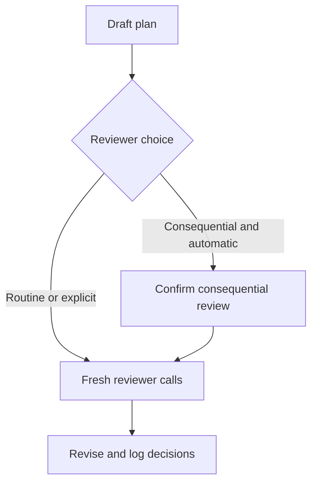

# Plan Challenge

**A cost-aware review workflow for AI-generated project plans.** Use Codex or Claude Code to draft a plan, send the draft to a fresh reviewer, and keep a decision log for the proposed changes.

Most plans get one low-effort Codex review. For consequential work, the skill recommends a deeper Claude review and asks you to choose. When you want two independent opinions, run both reviewers against the same draft before revising it.

## What the pilot found

| Historical experiment | Codex CLI | Claude subagent |
| --- | ---: | ---: |
| Seeded failures detected across repeated reviews | 24 / 24 | 24 / 24 |
| Mean reported tokens per seeded review | 8,249 | 62,641 |
| Accepted distinct findings on three real plans | 6 / 20 | 18 / 20 |
| Accepted findings unique to each reviewer | 2 | 14 |

The seeded test saturated. The two workflows reported **7.59× different mean token totals**, including different amounts of startup context. The three real plans gave a reason to pay for deeper review. Claude found 14 accepted issues Codex missed, and using both raised the observed union from 18 to 20. One plan's judgments were corrected after reviewer identities were revealed. These are historical workflow measurements. The current standalone runner and routing policy still need live evaluation.

- [Raw pilot results and limitations](docs/benchmarks.md)
- [Reproduce the arithmetic and inspect routing scenarios](evals/plan-review/)

## Try it

Clone this repository or extract GitHub's **Download ZIP**. From the repository root, open your preferred CLI. You need Python 3.9+ and a signed-in CLI for each writer or reviewer you use. For the default reviewer, install [Codex CLI](https://developers.openai.com/codex/cli) and run `codex login`. To use Claude as a writer or reviewer, install [Claude Code](https://code.claude.com/docs/en/quickstart) and sign in.

| Goal | Claude Code chat | Codex chat |
| --- | --- | --- |
| Let the skill pick or ask | `/challenge Plan a weekly attendance log` | `$challenge Plan a weekly attendance log` |
| Choose a deeper Claude review | `/challenge claude <idea>` | `$challenge claude <idea>` |
| Get two independent opinions | `/challenge both <idea>` | `$challenge both <idea>` |
| Compare reviewers with repeated runs | `/challenge measure <idea>` | `$challenge measure <idea>` |

You can also enter just the skill name to use the current discussion, or supply a Markdown plan path. Prefix with `codex` to explicitly use Codex, including for consequential plans. This repository is currently private and requires access to clone or download.

### Use it in another project

Copy the [entire skill folder](.claude/skills/challenge/) into the appropriate location. Keep `SKILL.md` and its supporting files together, then start a fresh session.

| Client | One project | All your projects |
| --- | --- | --- |
| Claude Code | `.claude/skills/challenge/` | `~/.claude/skills/challenge/` |
| Codex | `.agents/skills/challenge/` | `~/.agents/skills/challenge/` |

## How it works



- **Cost control.** The regular route uses one reviewer call. A blocker can trigger one recheck. `both` makes two independent calls on the same draft, and `measure` makes four.
- **Isolated review.** Each reviewer starts in a temporary directory and receives the frozen plan and rubric. The runner disables shell tools in Codex and tools in Claude, validates the reply format and keeps per-run usage fields. Remove secrets before sending plan text to a provider.
- **Audit trail.** The output folder keeps `plan-v1.md`, the original critiques, `decisions.md`, and the revised `plan.md`. A failed review is recorded explicitly. The skill stops at planning.

## Evaluation and engineering

The next benchmark contains **12 plans in six matched pairs**, with **9 seeded blockers and 3 major issues**. The paired controls test whether a reviewer withdraws the same claim after the flaw is repaired. The runner has a **12-call smoke budget** and a **48-call full budget**, with plan and rubric hashes, CLI versions, usage and failure logs. Model results for this suite are pending.

```sh
python -B -m unittest discover -s tests -v
python evals/plan-review/run_benchmark.py --suite full --dry-run
```

Start with the [real camera-swap decision log](challenge/shot-tracker-new-camera/decisions.md) for an example of reviewer disagreement, then see the [paired benchmark](evals/plan-review/) and [client verification guide](docs/verification.md).
