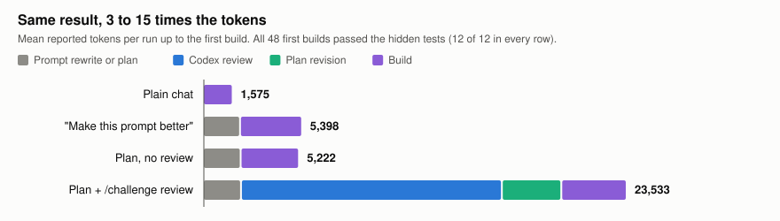

# Paired benchmark results (2026-11-19)

Live runs of both reviewers on the [12-plan paired benchmark](../evals/plan-review/). The plans, answer key, [scoring rules](../evals/plan-review/scoring.md) and [stakes labels](../evals/plan-review/stakes.jsonl) were frozen in commit `5aaacac` before the first call. All numbers below are measured from the saved usage files or counted from the grader's rows, unless marked otherwise.

## What was run

| Run | Calls | Completed | Evidence |
| --- | ---: | ---: | --- |
| Codex smoke (6 plans, once) | 6 | 6 | [runs/portfolio-smoke-codex](../runs/portfolio-smoke-codex/) |
| Codex full (12 plans, twice) | 24 | 24 | [runs/portfolio-full-codex](../runs/portfolio-full-codex/) |
| Claude smoke (6 plans, once) | 6 | 2 | [runs/portfolio-smoke-claude](../runs/portfolio-smoke-claude/) |
| Claude full (12 plans, twice) | 24 | 21 | [runs/portfolio-full-claude](../runs/portfolio-full-claude/) |
| **Total** | **60** | **53** | |

- Codex CLI 0.170.0, low effort. The CLI did not report which model it used.
- Claude CLI 2.1.319, medium effort, model `claude-fable-5-2` as reported by the CLI.
- Each reviewer got the plan and the rubric only, in an empty temporary folder with tools off.
- No failed call was rerun. One extra Claude call outside the 60 was made to diagnose the smoke failures. It is not scored.

Only the two full runs are scored. The smoke runs were for finding integration problems, and found one (below).

## Reviewer comparison (full runs)

| Measure | Codex | Claude |
| --- | ---: | ---: |
| Completed / attempted runs | 24/24 | 21/24 |
| Seeded blockers found | 18/18 | 18/18 |
| All seeded flaws found | 24/24 | 24/24 |
| Same, counting failed runs as finding nothing | 24/24 | 24/24 |
| Control runs that repeated a repaired flaw | 2/12 | 0/9 |
| Other findings judged valid | 17 | 37 |
| Other findings judged unsupported | 12 | 19 |
| Median total tokens per run | 14,184 | 2,417 |
| Median new input / cache read / cache write / output | 2,810 / 10,368 / 0 / 177 | 2 / 755 / 581 / 1,090 |
| Median wall time per run | 7.1 s | 17.9 s |
| Cost reported by the CLI | not reported | $1.21 over 21 runs (median $0.058) |

The full table as printed by the scorer is in [runs/portfolio-score/report.md](../runs/portfolio-score/report.md). Every finding has one row with a reason in [judgments.jsonl](../runs/portfolio-score/judgments.jsonl).

## Routing policies replayed on the same reviews

| Policy | Calls (failed) | Blockers found | Blocker misses on consequential plans | Total tokens | Total wall time |
| --- | ---: | ---: | ---: | ---: | ---: |
| Always Codex | 24 (0) | 18/18 | 0 | 335,826 | 181 s |
| Always Claude | 24 (3) | 18/18 | 0 | 52,122 | 404 s |
| Both | 48 (3) | 18/18 | 0 | 387,948 | 585 s |
| Routing rule (Claude on the 2 consequential pairs) | 24 (1) | 18/18 | 0 | 242,855 | 266 s |

The replay assumes the user accepts the Claude recommendation every time. It leaves out writer tokens and rechecks.

## What the results support

1. **Both reviewers found every planted flaw in every completed run.** The seeded test is too easy to separate them. It shows the pipeline works. It does not show one reviewer is better at catching blockers.
2. **Codex was faster and never failed the format check.** 7.1 s against 17.9 s median, 24/24 against 21/24 completed.
3. **Claude wrote more findings beyond the seeds.** 37 judged valid in 21 runs (1.8 per run) against 17 in 24 runs (0.7 per run). It also wrote more unsupported ones (0.9 against 0.5 per run). About two in three of Claude's extra findings and three in five of Codex's were judged valid.
4. **Claude never repeated a repaired flaw on a control. Codex did in 2 of 12 control runs**, both on the inventory control (p05). The grader marked both as borderline.
5. **The routing rule did not improve blocker recall here.** All four policies found 18/18. The case for sending consequential plans to Claude rests on finding 3, not on recall.

## Assumptions the data contradicts

- **"Claude costs about 7.6 times the tokens."** That came from the earlier pilot, where Claude ran as a subagent inside Claude Code and carried its startup context. In the standalone runner Claude used about one sixth of Codex's reported tokens (2,417 against 14,184 median). Codex's total is mostly cached input.
- **"Fewer tokens means cheaper."** Tokens are not dollars. Claude reported $0.058 per run. Codex reported no cost, so the dollar comparison is unknown. Most of Claude's tokens are output, which is priced higher than cached input.
- **"Codex is the low-cost default."** Supported for speed and reliability. Not supported for tokens. Unknown for dollars.

## Follow-up: Codex at medium effort

The main comparison has Codex at low effort and Claude at medium. To check whether that explains Claude's extra findings, Codex was run again on the same 12 plans, twice each, at medium effort (24 calls, 2026-11-19, [runs/matched-full-codex](../runs/matched-full-codex/)). Claude was not rerun because its runs were already at medium. A separate blind grader judged the 61 findings ([runs/matched-score-codex](../runs/matched-score-codex/)).

| Measure | Codex low | Codex medium | Claude medium |
| --- | ---: | ---: | ---: |
| Completed / attempted runs | 24/24 | 24/24 | 21/24 |
| Seeded blockers found | 18/18 | 18/18 | 18/18 |
| Control runs that repeated a repaired flaw | 2/12 | 2/12 | 0/9 |
| Other findings judged valid | 17 | 12 | 37 |
| Other findings judged unsupported | 12 | 23 | 19 |
| Median total tokens per run | 14,184 | 14,626 | 2,417 |
| Median wall time per run | 7.1 s | 13.9 s | 17.9 s |

- **Medium effort did not close the gap.** Codex wrote more findings at medium (61 against 55), but the extra ones were mostly judged unsupported. Valid extras per run were 0.5 at medium, 0.7 at low and 1.8 for Claude.
- **It cost about twice the time** (13.9 s against 7.1 s) for no gain in blockers found, which were already at the ceiling.
- **Both false alarms were again on the inventory control (p05)**, and the grader again marked them borderline.
- **Limits.** Each column was graded in a separate blind pass, and two passes over the same findings agreed on 85%, so the drop from 17 to 12 valid is within grading noise. The gap to Claude's 37 is not. The same effort label does not mean the same compute at two providers. The grader saw one reviewer's findings only, with no names.

## Follow-up: four tests of the idea itself (2026-11-20)

The benchmark above compares two reviewers with each other. These four tests ask whether the review step earns its place at all. The [rules](../evals/plan-review/followup.md) were committed before the first call. 141 live calls, none failed, none rerun. Grading is by an AI (Claude), blind. No person checked it. Raw replies are in `runs/followup-*`. The counts for tests 1 and 2 are printed by `python evals/plan-review/followup_report.py`.

**Two of the four results go against this repo's story.** They are reported as measured.

### 1. Does `/challenge` beat asking one model to "make it better"? Not on these plans.

| Measured, two runs per plan | "Make it better", Claude | "Make it better", Codex | Codex review, Claude revises | Claude review, Claude revises |
| --- | ---: | ---: | ---: | ---: |
| Final plans | 24 | 24 | 24 | 21 |
| Planted flaws fixed | 24 / 24 | 24 / 24 | 24 / 24 | 24 / 24 |
| Repaired plans with a repair removed | 0 / 12 | 0 / 12 | 0 / 12 | 0 / 9 |
| Final plans with a new defect | 0 / 24 | 0 / 24 | 0 / 24 | 0 / 21 |
| Median words in the final plan (original: 123) | 472 | 381 | 183 | 212 |
| Median reported tokens, all calls | 2,499 | 14,674 | 16,212 | 5,718 |
| Median wall time, all calls | 20.0 s | 13.3 s | 21.0 s | 41.5 s |

- **A one-line "make this plan better" in a fresh chat fixed every planted flaw**, with one call instead of two. The review step added nothing on this measure.
- **The only measured difference is size.** A plain rewrite made the plan three to four times longer. A review followed by a revision made it about one and a half times longer. The grader did not count the added length as a defect.
- **What the review route still gives** is a list of issues with a decision on each. This test does not measure whether that is worth the second call.
- **Strongest case against this result:** the planted flaws were already too easy for both reviewers, so any capable model fixes them. The test hit its ceiling and cannot show a gap in either direction. The grader also passed all 93 plans without one regression or new defect, which may mean it was lenient. Confidence that "make it better" matches the review route on easy, self-contained flaws: 80%. Confidence that this carries over to real plans with hidden context: 35%.

### 2. A second model, or the same model twice? The same model twice, if it is Claude.

Input: the 54 extra findings judged valid in the main benchmark, grouped by a blind grader into 26 distinct issues. Counted on the 9 plans where all four reviews completed.

| Distinct valid issues found, sum over 9 plans | Computed |
| --- | ---: |
| One Codex review (mean of two) | 4.5 |
| One Claude review (mean of two) | 16.0 |
| Codex twice | 6 |
| One Codex and one Claude (mean of four pairings) | 17.0 |
| Claude twice | 19 |
| All four reviews | 20 |

- **Adding Codex to one Claude review added 1.0 issue. Adding a second Claude review added 3.0.** The gain came from a second read, not from a different model.
- **Codex found 1 issue of the 20 that no Claude review found.**
- **Strongest case against:** the grader that judged the findings valid is Claude, and it may favour findings written the way Claude writes. The counts are small (20 issues, 9 plans). In the earlier pilot on three real plans, Codex raised 2 accepted issues that Claude did not. Confidence that Claude twice finds at least as many valid issues as one of each on plans like these: 70%.

### 3. Is Claude still less reliable with the current validator? No.

The Claude run was repeated with the validator as it ships now: **24 of 24 reviews passed the format check** (21 of 24 in the main run). The three earlier rejections were all a closing sentence after the required format, which the validator now drops. One rerun, not graded. Confidence that the format gap between the reviewers is closed: 75%.

### 4. Does the stakes rule fire correctly? On one of the two consequential pairs.

Each model classified each of the 12 plans once, using the wording of the skill.

| Measured | Codex | Claude |
| --- | ---: | ---: |
| Correct against the frozen labels | 10 / 12 | 10 / 12 |
| Routine plans called consequential | 0 / 8 | 0 / 8 |
| Inventory pair (customer money) called consequential | 2 / 2 | 2 / 2 |
| Forecast pair (deployed to stores) called consequential | 0 / 2 | 0 / 2 |

- **No false alarms, and both models missed the same pair.** The forecast plan says the service "will be deployed to stores", and neither model read that as material money.
- **Strongest case against the label:** a reasonable person could also call the forecast plan routine, so this may be a labelling disagreement, not a model error. Either way the rule as worded does not catch "an error here costs money later". Confidence that the rule misses indirect money risk: 65%.

### What this changes

- **The claim "a second model catches what the first misses" is not supported here.** The supported claim is narrower: a fresh read with no chat history finds real issues, and a second fresh read finds more.
- **When a plain "make it better" is enough:** short, self-contained plans where a longer plan is acceptable and no record of decisions is needed.
- **When the review route is the better fit (not measured, my reasoning):** when the plan should stay short, when each change needs a reason on record, or when the writer's chat holds context that a blind rewrite would overwrite.
- **Not tested:** real plans, flaws that need outside knowledge, and a long chat that already holds the reasoning.

## Follow-up: does the built code get better? (2026-11-20)

The tests above count review findings. This one checks the thing that gets built. Rules, tasks and the decision rule were committed before the first call ([outcome.md](../evals/outcome/outcome.md), commit `4158644`). Six small Python functions, each with a trap that the prompt reveals on a careful read. A fresh Claude builds each one twice in four ways, and hidden tests decide pass or fail. No AI grades anything. 138 live calls, none failed.



| Measured, 12 runs per arm | Plain chat | "Make this prompt better" | Plan, no review | Plan + `/challenge` |
| --- | ---: | ---: | ---: | ---: |
| First builds that pass the hidden tests | 12 / 12 | 12 / 12 | 12 / 12 | 12 / 12 |
| Mean tokens up to the first build | 1,575 | 5,398 | 5,222 | 23,533 |
| Median time up to the first build | 8.6 s | 31.4 s | 30.9 s | 56.9 s |
| Claude cost reported per run (Codex reports none) | $0.04 | $0.15 | $0.14 | $0.24 |
| Median length of the code | 21 lines | 91 lines | 74 lines | 83 lines |

**Result: plain chat won.** Every arm passed every hidden test on the first build, so preparation could not add anything, and it cost 3 to 15 times the tokens (computed from the means). The code from the prepared arms was about four times longer, because the plans and rewritten prompts asked for input checks and self-tests that the user never asked for.

**The decision rule, applied as written.** `/challenge` beat plain chat by 0 of 12, under the 2 needed: on small coding tasks like these the workflow is not worth its tokens. It beat the plan-only arm by 0 of 12: the review step added nothing measurable beyond writing the plan.

**Break-even (computed).** The review route spent about 22,000 tokens more than plain chat before the build finished. A reprompt costs roughly one more build with the old code attached: about 1,600 tokens for plain-chat code (assumed, no plain run needed a reprompt) and about 5,300 for the longer prepared code (measured median of 30 reprompts). So the workflow pays for itself only when it saves somewhere between 4 and 14 reprompts on a task of this size. Here there was nothing to save.

**The reviewer still found things to say.** Codex returned `BLOCKED` on 3 of the 12 plans and asked for changes on 6, for tasks that plain chat solved correctly with no plan at all. A review always has an opinion; that is not the same as the work needing one.

**A fault in my harness, found after the run.** The first grader pasted the model's code and the hidden tests into one file. The prepared arms wrote their own self-tests, which ran in place of the hidden ones, so 19 correct first builds were recorded as "crashed" and triggered 30 reprompts that should not have happened (one run looped to the limit of 10). The grader now imports the answer as a module. The table above is regraded offline from the saved first replies with no new model call; the tasks and hidden tests were not changed. As first recorded, the passes were 12, 5, 5 and 5 of 12. The 30 wasted reprompts are in the run files and are left out of the token numbers above.

Strongest case against this result: the test hit its ceiling. Six functions with every needed fact in the prompt are exactly the work a good model does right the first time, so the test could only show that planning costs more, never that it helps. It says nothing about work where the prompt is missing facts, where the plan would make the model ask a question, or where the mistake only shows up weeks later. Confidence that plain chat is the right choice for small, checkable coding tasks: about 85 percent. Confidence that this carries over to large or hard-to-check work: low, not tested.

Reprint the numbers with `python evals/outcome/outcome.py report`.

### When to use which (my rule after all the tests)

| Use plain chat when | Use `/challenge` when |
| --- | --- |
| You can check the result in under a minute (run it, look at it) | A wrong plan is only discovered after hours of work or after money is spent |
| It is easy to undo | It is hard to undo (a purchase, a data migration, a public release) |
| The task is small and every needed fact is in your message | The plan rests on assumptions that running the code will not reveal |
| | You want a short plan with a written reason for each change |

The first column is measured here. The second is supported only by the pilot on three real plans (20 issues, all accepted) and is otherwise my reasoning.

## Failures

- **Outcome test, grader fault.** 19 correct first builds were recorded as failures because the answers' own self-tests ran in place of the hidden tests. Fixed and regraded offline; details in the outcome section above.
- **Outcome test, grader could be fooled.** An outside review of the code found that an answer could print `PASS` and exit, or read the hidden tests from its own folder, and be graded as passing. The grader now feeds the tests to Python without a file and accepts a pass only with a random token. All 48 saved first builds and all 47 final accepted answers were regraded offline with it and still pass; no saved answer used the hole. The tests still run in the same process as the answer, so this stops accidents and simple tricks, not hostile code.
- **Claude smoke, 4 of 6 rejected.** The validator had a hard 250-word limit and Claude wrote slightly more (270 words on the one reply inspected). The limit in the validator was raised to 400 words before the full run. The rubric text the reviewers see was not changed, so the Codex runs stay comparable. The 4096-byte cap still applies.
- **Claude full, 3 of 24 rejected.** All three added a sentence of plain text after the required format: two "NO BLOCKING ISSUES" replies with an explanation, one review with a closing remark. All three were on control plans, which is why the recall numbers do not change when failed runs count as zero. The raw replies are saved next to the runs as `.rejected.txt`. After the benchmark the validator was changed to drop such a closing remark and keep the review. Replayed offline, it accepts all three saved replies. The benchmark numbers above are not recomputed: these three stay counted as failed and were not graded.

## How sure are the counts?

Exact 95% intervals (Clopper-Pearson), computed by [evals/intervals.py](../evals/intervals.py). They assume independent trials. The two repeats of each plan or task are related, so the real uncertainty is wider.

| Count | Measured | 95% interval for the true rate |
| --- | ---: | --- |
| First builds that passed, outcome test (each arm) | 12 / 12 | 73.5% to 100% |
| Planted blockers found (each reviewer) | 18 / 18 | 81.5% to 100% |
| Format check passed, Codex | 24 / 24 | 85.8% to 100% |
| Format check passed, Claude, main run | 21 / 24 | 67.6% to 97.3% |
| Format check passed, Claude, current validator | 24 / 24 | 85.8% to 100% |
| Planted flaws fixed by "make it better" (each arm) | 24 / 24 | 85.8% to 100% |
| Stakes rule correct (each model) | 10 / 12 | 51.6% to 97.9% |
| Two blind graders agreed on a Codex finding | 47 / 55 | 73.3% to 93.5% |

"All passed" here means the true rate is probably above three quarters, not that it is 100%. A tie such as 12/12 against 12/12 cannot separate two methods whose real pass rates are 80% and 100%.

## Limits

- The plans are synthetic and were written with AI help. Both splits are development data. This is not independent validation.
- The grader is an AI (Claude), which is one of the two reviewer families. It graded blind: random file names, no reviewer names, no usage files. No person has checked the judgments.
- Grading is not fully repeatable. The 55 Codex findings were graded twice by separate blind graders. They agreed on 47 (85%). All disagreements were between valid, unsupported and unclear. None changed a seed match or a false alarm. The earlier pass is kept in [runs/portfolio-score-codex](../runs/portfolio-score-codex/).
- Two repeats of the same plan are related, not independent. Twelve plans is a small set.
- Effort settings differ in the main comparison (Codex low, Claude medium), as the skill ships them. The follow-up above reruns Codex at medium.
- The Codex model is unknown because the CLI did not report it.

## What I would do next

- Write harder plans, where a flaw only shows when two steps are read together, so the blocker test stops hitting its ceiling.
- Have a person grade a sample of the findings and compare with the AI grader.
- Reword the stakes rule so it catches plans where an error costs money later, and test it again.
- Repeat the "make it better" comparison on real plans, where the writer's chat holds context the plan text does not.
- Rerun the outcome test on tasks where the prompt leaves out a needed fact, so plain chat no longer passes everything on the first build.

## Reproduce

```text
python evals/plan-review/run_benchmark.py --suite full --provider codex --out runs/my-codex
python evals/plan-review/run_benchmark.py --suite full --provider claude --out runs/my-claude
python evals/plan-review/score.py blind runs/my-codex runs/my-claude --out runs/my-score
python evals/plan-review/score.py report runs/my-score
```

The `report` step needs a `judgments.jsonl` written by a grader who follows [scoring.md](../evals/plan-review/scoring.md).
